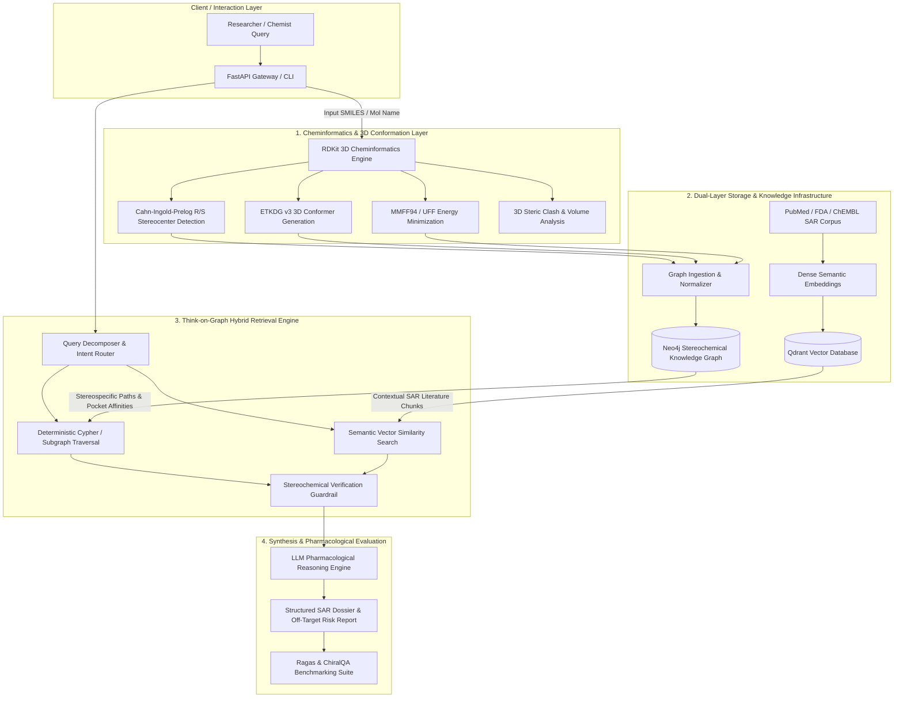

# ChiralGraph-RAG: Architecture Specification

## 1. System Overview

**ChiralGraph-RAG** is a 3D conformation and stereoisomer-aware Knowledge Graph Retrieval-Augmented Generation (GraphRAG) system engineered for computational drug discovery and pharmacological reasoning.

### The Problem It Solves: The 2D Stereochemical Blindspot
Conventional LLM-based RAG systems for molecular sciences rely on 1D representations (IUPAC names, SMILES strings) and unstructured text embeddings. Consequently, they suffer from a fundamental failure mode:
* Mirror-image stereoisomers (**enantiomers**) share identical atomic connectivity, 2D topology, molecular weights, and often identical textual representations in standard corpora.
* In biological systems, chirality dictates target pocket fit, binding free energy ($\Delta G$), pharmacokinetics, and toxicity. One enantiomer may be a potent therapeutic while its counterpart is biologically inert, counteractive, or lethal (e.g., $(R)$-Thalidomide sedative vs. $(S)$-Thalidomide teratogen; $(S)$-Citalopram active SSRI vs. $(R)$-Citalopram allosteric inhibitor; $(S)$-Levofloxacin bactericidal vs. $(R)$-Ofloxacin nephrotoxic).
* Standard dense vector search merges or confuses these citations, leading to **hallucinated safety profiles** and dangerous misinformation.

ChiralGraph-RAG eliminates this blindspot by bridging **3D computational cheminformatics (RDKit)** with a **heterogeneous stereochemical Knowledge Graph (Neo4j / NetworkX)**, **hybrid vector retrieval (Qdrant)**, and **deterministic graph-guided LLM reasoning (Think-on-Graph protocol)**.

---

## 2. High-Level Architecture Diagram



---

## 3. Component Deep Dive

### Component 1: RDKit 3D Cheminformatics Engine (`src/cheminformatics/`)
* **Stereocenter Resolution**: Uses the Cahn-Ingold-Prelog (CIP) priority rules to identify tetrahedral chiral centers and $E/Z$ geometrical isomerism.
* **Stereoisomer Enumeration**: Given unassigned or racemic molecules, computes all valid chiral permutation stereoisomers ($2^n$ where $n$ is unassigned chiral centers).
* **3D Conformer Generation**: Implements the **ETKDG v3** (Experimental-Torsion Knowledge Distance Geometry) algorithm to construct low-energy 3D molecular conformations.
* **Force Field Minimization**: Relaxes 3D coordinates using **MMFF94** (Merck Molecular Force Field) to compute conformational strain energies ($\Delta E_{\text{strain}}$ in kcal/mol).
* **3D Descriptors**: Generates 3D molecular surface area, principal moments of inertia, and chiral volume descriptors.

### Component 2: Stereochemical Knowledge Graph (`src/graph/`)
The graph captures explicit biochemical and biophysical relationships, preventing hallucinations of non-existent drug-target interactions.
* **Nodes**:
  * `ParentDrug`: Chemical entity level (e.g., Citalopram, Thalidomide).
  * `Stereoisomer`: Specific chiral state (e.g., $(S)$-Citalopram / Escitalopram, $(R)$-Citalopram) with 3D energy and SMILES.
  * `Target`: Macromolecular protein/receptor (e.g., Serotonin Transporter SERT, hERG Potassium Channel, Cereblon CRBN).
  * `BindingPocket`: Specific active or allosteric site on the target.
  * `AffinityAssay`: Quantitative binding parameters ($K_d, K_i, \text{IC}_{50}$, assay type, units).
  * `Liability / AdverseEvent`: Clinical hazards (e.g., QT prolongation, Teratogenicity, Hepatotoxicity).
* **Edges**:
  * `(:ParentDrug)-[:HAS_STEREOISOMER]->(:Stereoisomer)`
  * `(:Stereoisomer)-[:BINDS_TARGET {kd: float, ki: float, affinity_type: string}]->(:Target)`
  * `(:Stereoisomer)-[:OCCUPIES_POCKET {steric_clash_score: float}]->(:BindingPocket)`
  * `(:Stereoisomer)-[:TRIGGERS_LIABILITY {severity: string}]->(:Liability)`
  * `(:Stereoisomer)-[:ALLOSTERICALLY_INHIBITS]->(:Stereoisomer)`

### Component 3: Vector Knowledge Store (`src/vector/`)
* Indexes experimental pharmacology literature, clinical assay protocols, SAR papers, and FDA drug insert documents.
* Each chunk is metadata-tagged with:
  * `chiral_tag`: Specific isomer $(R)$, $(S)$, or racemic $(R/S)$.
  * `target_name`: Protein receptor symbol.
  * `evidence_type`: In vitro, in vivo, or clinical trial.

### Component 4: Hybrid Think-on-Graph Retriever (`src/engine/`)
Inspired by Sun et al. (*Think-on-Graph*, ICLR 2024) and Wen et al. (*MindMap*):
1. **Stereocenter Disambiguation**: Checks if the query references a chiral compound.
2. **Explicit Graph Path Tracing**: Extracts multi-hop relational paths from the Knowledge Graph:
   $$\text{Query Molecule} \xrightarrow{\text{HAS\_ISOMER}} \text{Isomer } (R/S) \xrightarrow{\text{BINDS}} \text{Target} \xrightarrow{\text{TRIGGERS}} \text{Clinical Liability}$$
3. **Stereochemical Guardrail Gate**: Filters vector search results to prevent cross-contamination where literature about an $(R)$-enantiomer is accidentally attributed to an $(S)$-enantiomer.
4. **Context Fusion**: Combines deterministic graph triples ($K_d, K_i$, pocket residues) with nuanced narrative literature context.

### Component 5: Synthesis & Benchmarking (`src/engine/` & `src/evaluation/`)
* **Grounded SAR Generation**: Generates structured reports covering primary target affinity, stereochemical selectivity ratio ($\frac{K_i(R)}{K_i(S)}$), off-target risk profiles (hERG cardiotoxicity, CYP enzyme inhibition), and recommended modification strategies.
* **Ragas & ChiralQA Benchmark**: Evaluates Faithfulness, Context Precision, and Stereoisomer Discrimination Accuracy against baseline naive vector RAG.

---

---

## 4. Web Application & 3D Conformer Studio Architecture

```mermaid
flowchart LR
    subgraph Browser Client
        UI[Clean White & Brick Red Dashboard]
        Viewer3D[3Dmol.js WebGL Engine]
        ZoomControl[Discrete Zoom Controller: 50%-150%]
        MaxView[Fullscreen / Maximize Viewport Engine]
    end

    subgraph FastAPI Gateway
        App[FastAPI Async Server]
        NoCache[NoCacheStaticFiles Middleware]
        ChemEndpoint[/api/v1/cheminformatics/analyze]
        GraphEndpoint[/api/v1/graph/drug]
        RAGEndpoint[/api/v1/rag/query]
    end

    UI --> App
    NoCache --> UI
    App --> ChemEndpoint & GraphEndpoint & RAGEndpoint
    ChemEndpoint -->|SDF MolBlock + MMFF94 Strain| Viewer3D
    ZoomControl -->|Clamped Scale Factor| Viewer3D
    MaxView -->|Dynamic Resize: 100vw x 100vh| Viewer3D
```

### 4.1 Client-Side WebGL Conformer Studio (`ui/`)
* **3Dmol.js WebGL Visualization**: Renders true 3D molecular structures derived from RDKit ETKDG v3 distance geometry and MMFF94 force field optimization.
* **Scroll-Wheel Event Isolation**: To prevent erratic scaling and accidental page jumps, mouse wheel zoom is permanently neutralized at both the `$3Dmol.GLViewer.prototype._handleMouseScroll` prototype level and via capture-phase DOM interception.
* **Deterministic Discrete Zoom**:
  * Zoom is controlled strictly via a dedicated slider and `+` / `−` step buttons bounded between **50% and 150%** (100% standard baseline framing).
  * Step increment is standardized to **5%** (`+5%` and `−5%`).
  * Smooth camera centering resets to standard baseline coordinates.
* **Fullscreen / Maximize View Mode**:
  * Clicking **`⛶ Maximize`** expands the 3D WebGL viewport into a full-screen cinematic overlay (`100vw × 100vh`).
  * Automatically recalculates aspect ratios via `viewer3d.resize()`.
  * Allows keyboard dismissal via the `Escape` key or the **`🗗 Minimize`** button.
* **Cache-Busting Delivery**:
  * Implements `NoCacheStaticFiles` in FastAPI and versioned script tags (`?v=...`) to ensure development hot-reloads and client-side updates are immediately reflected without stale browser disk caching.

---

## 5. Production Containerization & Orchestration Architecture

```mermaid
flowchart TD
    subgraph Docker Compose Multi-Profile Stack
        direction TB
        subgraph Core Service
            AppContainer[chiralgraph-rag-app: Python 3.11-slim]
            AppContainer -->|Exposes Port 8000| HostPort[Host: http://localhost:8000]
        end

        subgraph Full Stack Profile: --profile full
            Neo4jContainer[(chiralgraph-neo4j: Neo4j 5.15 Community)]
            QdrantContainer[(chiralgraph-qdrant: Qdrant v1.7.4)]
            Neo4jContainer -->|Bolt: 7687, HTTP: 7474| AppContainer
            QdrantContainer -->|REST: 6333, gRPC: 6334| AppContainer
        end
    end
```

### 5.1 Multi-Stage Containerfile (`Dockerfile`)
* **Base Layer**: `python:3.11-slim` (Debian Bookworm) providing an optimal balance between low attack surface and pre-compiled wheel compatibility.
* **System Graphics & Scientific Libraries**: Installs `libxrender1`, `libxext6`, `libsm6`, and `libglib2.0-0` to ensure headless RDKit 2D/3D coordinate generation and format conversions function without runtime shared-library missing errors.
* **Layer Caching**: `requirements.txt` is installed in an isolated layer prior to copying application source code.
* **Non-Root Execution**: Runs under a dedicated `appuser` (UID 1000) for hardened container security.
* **Automated Healthcheck**: Periodically probes `http://localhost:8000/health` every 30 seconds with a 10-second startup grace period.

### 5.2 Compose Profiles (`docker-compose.yml`)
* **Default Mode (Standalone)**: Runs `chiralgraph-rag` in zero-dependency offline mode with NetworkX and in-memory vector storage.
* **Full Stack Profile (`--profile full`)**: Automatically provisions and networks persistent `neo4j` (with volume mounts) and `qdrant` vector database containers.

---

## 6. Dual-Mode Deployment Strategy

To ensure seamless execution across any environment:
1. **Offline / In-Memory Mode (Zero Setup)**:
   * Uses **NetworkX** for in-memory graph operations with an equivalent Cypher-like query interface.
   * Uses in-memory vector indexing with cosine similarity.
   * Runs local or mock LLM synthesis.
2. **Production Enterprise Mode**:
   * Connects to **Neo4j** (Aura Cloud or Local Docker via Bolt protocol).
   * Connects to **Qdrant** for persistent dense vector similarity.
   * Uses **Groq (Llama 3.3 70B)** or **OpenAI (GPT-4o)** for ultra-fast reasoning.
