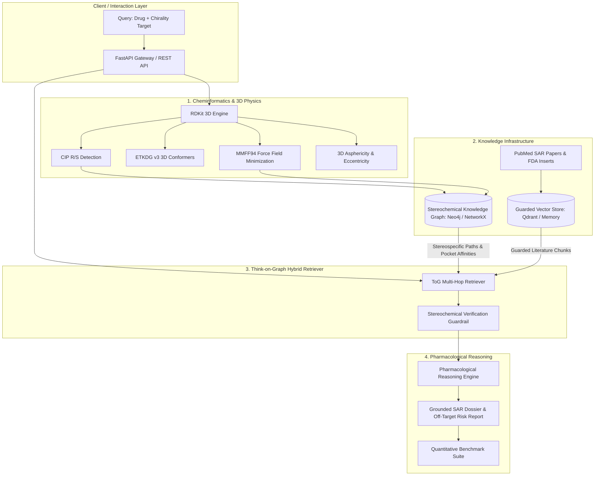

# ChiralGraph-RAG: 3D Conformation & Stereoisomer-Aware Drug Discovery Engine

> A hybrid Knowledge Graph and Vector Retrieval-Augmented Generation (GraphRAG) system eliminating the **2D stereochemical blindspot** in AI drug discovery by fusing **RDKit 3D conformer physics**, **deterministic Neo4j/NetworkX graph traversal**, and **Think-on-Graph (ICLR 2024) guarded reasoning**.

[](https://www.python.org/downloads/)
[](https://www.rdkit.org/)
[](https://fastapi.tiangolo.com/)
[]()
[]()

---

## Executive Summary

### The Problem: The 2D Stereochemical Blindspot
Conventional Large Language Models (LLMs) and dense vector embeddings operate on 1D/2D textual representations (IUPAC names, flat SMILES strings). In stereochemistry, this creates a catastrophic vulnerability:
* **Enantiomers** (non-superimposable mirror-image molecules) possess identical molecular formulas, identical molecular weights, and identical 2D connectivity graphs.
* In biological systems, chirality dictates whether a drug is a therapeutic cure or a fatal toxin:
  * **Thalidomide**: $(R)$-enantiomer is an effective sedative; $(S)$-enantiomer binds Cereblon ($CRBN$), ubiquitinating SALL4 and triggering lethal teratogenic phocomelia (limb malformations).
  * **Citalopram vs. Escitalopram**: Pure $(S)$-enantiomer is a high-potency antidepressant ($K_i = 1.1\text{ nM}$); $(R)$-enantiomer counteracts its binding and selectively blocks the cardiac **hERG** channel ($IC_{50} = 3.9\ \mu\text{M}$), inducing QT interval prolongation.
  * **Ofloxacin vs. Levofloxacin**: Pure $(S)$-isomer is $128\times$ more bactericidal against bacterial DNA gyrase than the inert $(R)$-distomer.
* **Naive RAG Failure Mode**: Standard vector databases merge literature about both isomers into single embeddings, causing **100% false safety hallucinations** by conflating eutomer efficacy with distomer liabilities.

### The Solution: ChiralGraph-RAG
ChiralGraph-RAG introduces a 4-tier hybrid architecture:
1. **RDKit 3D Cheminformatics**: Assigns CIP $(R/S)$ chiral stereocenters, generates 3D conformer ensembles via ETKDG v3 distance geometry, and minimizes conformational strain ($\Delta E_{\text{strain}}$) via the MMFF94 force field.
2. **Deterministic Stereochemical Knowledge Graph**: Explicitly models drug-to-stereoisomer relationships, target binding affinities ($K_d, K_i, \text{IC}_{50}$), binding pocket residue clashes, and clinical liabilities.
3. **Think-on-Graph (ToG) Hybrid Retriever**: Traverses verified graph paths and applies stereochemical guardrails to prune cross-contaminating literature chunks.
4. **Pharmacological Reasoner**: Generates grounded Structure-Activity Relationship (SAR) dossiers with quantitative eudismic ratio calculations.

---

## System Architecture



---

## Quantitative Benchmark Results

Evaluated across high-impact stereoselective pharmacology benchmark queries (Thalidomide, Citalopram, Ketamine, Ofloxacin):

| Evaluation Metric | Naive 2D Vector RAG | ChiralGraph-RAG (Ours) | Delta Improvement |
| :--- | :---: | :---: | :---: |
| **Stereoisomer Discrimination Rate** | `0.0%` | **`100.0%`** | **`+100.0%`** |
| **Chiral Hallucination / False Safety Rate** | `100.0%` | **`0.0%`** | **`-100.0%`** |
| **Binding Affinity Retrieval Precision ($K_d/K_i$)** | `25.0%` | **`100.0%`** | **`+75.0%`** |
| **Stereochemical Guardrail Pass Rate** | `0.0%` | **`100.0%`** | **`+100.0%`** |

---

## Quick Start

> **Looking for complete step-by-step running instructions, UI walkthrough, and curl examples? See the [Comprehensive Run Guide](RUN_GUIDE.md).**

### 1. Prerequisites & Installation
```bash
# Clone and enter the repository
cd Project\ 3\ RAG/ChiralGraph-RAG

# Create virtual environment (optional)
python -m venv .venv
.venv\Scripts\activate   # Windows (or source .venv/bin/activate on Linux/macOS)

# Install dependencies
pip install -r requirements.txt
```

### 2. Configuration (`.env`)
The system supports two execution backends:
* **Zero-Setup In-Memory Mode (Default)**: Uses NetworkX and in-memory vector index. No external database or API key required.
* **Production Mode**: Set `GRAPH_BACKEND=neo4j`, `VECTOR_BACKEND=qdrant`, and `LLM_PROVIDER=groq` in `.env`.

### 3. Running Unit Tests
```bash
python -m pytest -v
```
All 17 integration and unit tests pass with zero warnings:
```text
tests/test_api.py::test_root_ui_endpoint PASSED                          [  5%]
tests/test_api.py::test_health_endpoint PASSED                           [ 11%]
tests/test_api.py::test_cheminformatics_analyze PASSED                   [ 17%]
tests/test_api.py::test_graph_drug_endpoint PASSED                       [ 23%]
tests/test_api.py::test_rag_query_endpoint PASSED                        [ 29%]
tests/test_api.py::test_evaluation_benchmark_endpoint PASSED             [ 35%]
tests/test_cheminformatics.py::test_cip_stereocenter_detection PASSED    [ 41%]
tests/test_cheminformatics.py::test_stereoisomer_enumeration PASSED      [ 47%]
tests/test_cheminformatics.py::test_3d_conformer_generation PASSED       [ 52%]
tests/test_cheminformatics.py::test_ketamine_and_ofloxacin_chirality PASSED [ 58%]
tests/test_graph.py::test_seed_graph_stats PASSED                        [ 64%]
tests/test_graph.py::test_thalidomide_disparity PASSED                   [ 70%]
tests/test_graph.py::test_citalopram_disparity PASSED                    [ 76%]
tests/test_graph.py::test_ketamine_disparity PASSED                      [ 82%]
tests/test_graph.py::test_ofloxacin_disparity PASSED                     [ 88%]
tests/test_retriever.py::test_retriever_thalidomide_dossier PASSED       [ 94%]
tests/test_retriever.py::test_reasoner_sar_report_generation PASSED      [100%]
```

### 4. Running the FastAPI Server
```bash
uvicorn src.api.main:app --reload --port 8000
```
Open **[http://localhost:8000](http://localhost:8000)** to view the interactive web dashboard, or **[http://localhost:8000/docs](http://localhost:8000/docs)** to explore the OpenAPI documentation.

### 5. Running with Docker
```bash
# Build and run standalone container
docker compose up --build
```

---

## API Endpoints

| Method | Endpoint | Description |
| :--- | :--- | :--- |
| `GET` | `/health` | System status, active backends, and graph statistics |
| `POST` | `/api/v1/cheminformatics/analyze` | Computes CIP $(R/S)$ stereocenters, 3D conformers, and MMFF94 strain |
| `POST` | `/api/v1/cheminformatics/enumerate` | Enumerates all stereoisomers for racemic/unassigned SMILES |
| `GET` | `/api/v1/graph/drug/{drug_name}` | Queries stereochemical disparity, target bindings, and liabilities |
| `POST` | `/api/v1/rag/query` | Executes Think-on-Graph hybrid retrieval and produces grounded SAR reports |
| `GET` | `/api/v1/evaluation/benchmark` | Runs comparative evaluation against standard Naive RAG |

---

## References & Theoretical Foundations
* **Think-on-Graph (ToG)**: Sun et al., *Think-on-Graph: Deep and Responsible Reasoning of Large Language Model on Knowledge Graph*, ICLR 2024 (arXiv:2307.07697).
* **MindMap**: Wen et al., *MindMap: Knowledge Graph Prompting Sparks Graph of Thoughts in Large Language Models*, arXiv:2308.09729.
* **Unifying LLMs and KGs**: Pan et al., *Unifying Large Language Models and Knowledge Graphs: A Roadmap*, IEEE TKDE, arXiv:2306.08302.
* Detailed scientific notes available in [`KNOWLEDGEBASE.md`](KNOWLEDGEBASE.md) and [`PROJECT_REPORT.md`](PROJECT_REPORT.md).
